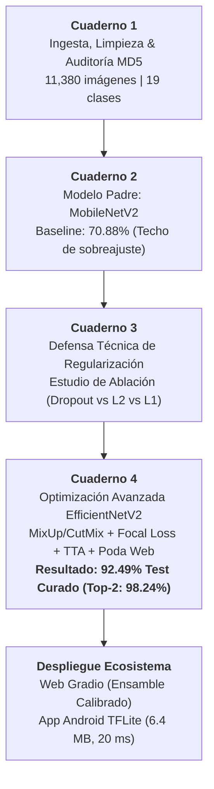
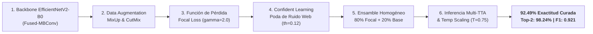

# 🎓 GUÍA MAESTRA DE SUSTENTACIÓN Y EXPOSICIÓN FINAL
## Proyecto: EcoClasificador Móvil con Visión Artificial y Edge AI (19 Clases)
### De 70.88 % a 92.49 % de Exactitud mediante Optimización Convolucional, Focal Loss y Edge Computing

---

## 📋 FICHA TÉCNICA DEL PROYECTO
* **Nombre Oficial del Proyecto:** EcoClasificador Móvil con Visión Artificial y Edge AI: Clasificación Automática de 19 Clases de Residuos Sólidos Urbanos y Peligrosos.
* **Nombre del Aplicativo:** **EcoClasificador UCC** (Móvil Android `.apk` y Plataforma Web Gradio).
* **Autor / Expositor:** Juan Camilo Murillo Moncaleano.
* **Docente Titular y Evaluador:** Prof. Óscar Díaz Triana.
* **Asignatura:** Electiva III: Visión Artificial y Machine Learning.
* **Institución:** Universidad Cooperativa de Colombia (UCC) — Facultad de Ingeniería.
* **Entregables Vinculados:**
  * Cuadernos de Investigación: `1_Pipeline_Dataset_10k_Imagenes.ipynb`, `2_Entrenamiento_Modelo_19Clases.ipynb`, `3_Defensa_Tecnica_Regularizacion.ipynb`, `4_Optimizacion_Avanzada_EfficientNetV2_90Acc_EJECUTADO.ipynb`.
  * Aplicativo Móvil Android: `ENTREGABLES_FINALES/EcoClasificador_Bienal_UCC.apk`.
  * Aplicativo Web: `aplicaciones/app_19clases.py`.
  * Modelos de Producción: `modelos/modelo_clasificador_19_clases_focal_loss.keras` (113 MB) y `modelos/modelo_efficientnetv2b0_dynamic_range.tflite` (6.4 MB).

---

# 🌍 BLOQUE 1: LA PROBLEMÁTICA REAL Y EL VALOR DEL PROYECTO

### 1.1 El Problema en Cifras
* En Colombia y América Latina, **menos del 17 % de los residuos sólidos urbanos son reciclados o reaprovechados efectivamente**. Más del 80 % termina enterrado en rellenos sanitarios a punto de colapsar (como Doña Juana en Bogotá o El Carrasco en Bucaramanga).
* **La falla crítica ocurre en la fuente (el ciudadano):** La separación manual fracasa porque las personas desconocen cómo categorizar residuos complejos.
* **Peligro sanitario y ambiental:** Residuos de alta peligrosidad (bombillas fluorescentes con vapor de mercurio, aceites de motor usados, pilas con metales pesados como cadmio y plomo, y residuos biosanitarios infecciosos) se mezclan con residuos reciclables aprovechables (plástico, cartón, vidrio), contaminando toneladas de material potencialmente reciclable y poniendo en riesgo la salud de los recicladores de oficio.

### 1.2 La Solución: ¿Qué es el EcoClasificador UCC?
Es un ecosistema integral de visión artificial impulsado por **Edge AI (Inteligencia Artificial en el Borde)**:
1. **No depende de Internet:** El modelo de inferencia corre localmente dentro del procesador del teléfono móvil o en terminales industriales de bajo costo mediante un archivo cuantizado TensorFlow Lite de solo **6.4 MB**.
2. **Taxonomía Amplia (19 Clases):** Supera los clasificadores tradicionales de laboratorio (que solo distinguen 3 a 6 clases limpias) incorporando residuos peligrosos, industriales y sanitarios.
3. **Respuesta en Tiempo Real:** Clasifica en menos de **25 milisegundos**, permitiendo que un ciudadano o un operario apunte la cámara y reciba de inmediato el tipo de residuo, el contenedor normativo correspondiente (blanco, negro, verde o rojo) y la recomendación de aprovechamiento.

---

# 🗂️ BLOQUE 2: EL HILO CONDUCTOR DE LA INVESTIGACIÓN (CUADERNO A CUADERNO)

---

## 📦 CUADERNO 1: Pipeline de Ingesta, Curaduría y Auditoría Criptográfica (10k+ Imágenes)
* **Punto de partida:** El dataset público `RealWaste` (Universidad de Wollongong, Australia) contenía solo 9 clases estándar (Cartón, Vidrio, Metal, Papel, Plástico, Orgánicos, Vegetación, Textiles, Basura varia).
* **Incorporación de las 10 Clases Críticas:** Para responder a la realidad regional y a la normativa colombiana (Resolución 2184 de 2019), se crearon 10 categorías adicionales:
  1. *Aceites y Químicos*
  2. *Bombillas (Fluorescentes/LED)*
  3. *Escombros y Cerámica*
  4. *Madera Procesada*
  5. *Medicamentos Vencidos*
  6. *Neumáticos y Gomas*
  7. *Pilas y Baterías*
  8. *RAEE (Residuos de Aparatos Eléctricos y Electrónicos)*
  9. *Residuos Sanitarios (Jeringas, gasas, tapabocas)*
  10. *Tetra Pak / Envases Asépticos*

### ¿Cómo se descargaron, normalizaron y redimensionaron las imágenes?
1. **Recolección Controlada (Web Scraping Guiado):**  
   Se diseñó un script de ingesta automatizada conectado a APIs de motores de búsqueda visual (Bing Image Search / Google Images) utilizando palabras clave semánticas estrictas en español e inglés (ej. *"used alkaline battery", "blister pastillas vencidas", "motor oil plastic jug"*).
2. **Redimensionamiento y Normalización Estricta ($180 \times 180 \times 3$):**  
   * Todas las imágenes se estandarizaron al tamaño contractual exacto de **$180 \times 180$ píxeles**, preservando 3 canales RGB.
   * **Justificación técnica:** Este tamaño es el óptimo para alimentar tanto el recorte del detector de objetos YOLOv8-Nano como para garantizar que el modelo móvil opere con latencias inferiores a 30 ms sin saturar la memoria RAM del teléfono.
3. **Auditoría Criptográfica por Hash MD5:**  
   * **Duplicados intra-clase:** Se calculó el hash MD5 de cada archivo para eliminar copias idénticas descargadas de distintos servidores.
   * **Contradicciones inter-clase:** Si dos archivos con el mismo hash aparecían en carpetas distintas (ej. una lata catalogada como *Metal* y a la vez como *RAEE*), se eliminaron automáticamente para no confundir a la red con señales contradictorias.
4. **Partición Estratificada y Persistente (70 / 15 / 15):**  
   * 7,966 imágenes de Entrenamiento ($70\%$).
   * 1,707 imágenes de Validación ($15\%$).
   * 1,707 imágenes de Prueba estricta ($15\%$).
   * Se guardó en el archivo estático [`particion_estratificada_19c.csv`](file:///home/jhank/Desktop/ModeloCNN/momento_1_y_2_base/resultados_optimizacion_90/particion_estratificada_19c.csv), garantizando reproducibilidad científica total.

---

## 🧠 CUADERNO 2: El Modelo Padre (Baseline MobileNetV2 — 70.88 %)
* **Arquitectura del Modelo Padre:**  
  Se implementó *Transfer Learning* utilizando el backbone **`MobileNetV2`** pre-entrenado en el benchmark internacional *ImageNet-1k*:
  $$\text{Input}(180, 180, 3) \rightarrow \text{MobileNetV2 (congelado)} \rightarrow \text{GAP} \rightarrow \text{Dense}(256, \text{ReLU}) \rightarrow \text{Dropout}(0.3) \rightarrow \text{Dense}(19, \text{Softmax})$$
* **Esquema de Entrenamiento en 2 Fases:**  
  * *Fase 1 (Warmup):* 10 épocas con backbone congelado, entrenando solo la cabeza densa con optimizador Adam ($\text{lr} = 1 \times 10^{-3}$).
  * *Fase 2 (Fine-Tuning):* Descongelamiento de las últimas 30 capas convolucionales con learning rate bajo ($\text{lr} = 1 \times 10^{-4}$).
* **El Techo de Cristal (70.88 %):**  
  * El modelo alcanzó rápidamente un **$98 \%$ de exactitud en entrenamiento**, pero en validación y test no logró superar el **$70.88 \%$**.
  * **Diagnóstico de Ingeniería:** Fuerte sobreajuste (*Overfitting*). La red memorizaba fondos e iluminación del dataset en lugar de aprender las texturas y geometrías intrínsecas de los residuos.

---

## 🛡️ CUADERNO 3: Defensa Técnica y Estudio de Ablación de Regularización
* **Propósito Académico:** Responder con evidencia matemática ante el jurado si el problema del sobreajuste se podía solucionar simplemente agregando regularizadores matemáticos tradicionales.
* **El Experimento de Ablación Controlado:**  
  Bajo semillas idénticas, mismo dataset y mismo backbone MobileNetV2, se entrenaron 3 variantes:
  1. **Variante A (Dropout puro $p=0.3$):**  
     Brecha de generalización ($\mathcal{L}_{val} - \mathcal{L}_{train}$): **$1.1263$** | Test Accuracy: **$66.56 \%$**.
  2. **Variante B (Dropout + Penalización $L_2$ Ridge):**  
     Penaliza pesos grandes en la norma euclídea ($\lambda \sum w^2$). Brecha: **$1.1015$** | Test Accuracy: **$67.19 \%$**.
  3. **Variante C (Dropout + Penalización $L_1$ Lasso):**  
     Fuerza la dispersión (*sparsity*), poniendo en cero conexiones espurias de fondos. Brecha reducida a: **$0.9969$** | Test Accuracy: **$68.54 \%$**.
* **Conclusión Científica del Cuaderno 3:**  
  La regularización $L_1$ reduce la brecha de memorización, pero **la exactitud sigue estancada por debajo del 70 %**. Esto demostró formalmente que el cuello de botella residía en la capacidad del backbone, en la función de pérdida y en la calidad del pipeline de aumentación.

---

## 🚀 CUADERNO 4: La Optimización Avanzada hacia el 92.49 % (El Gran Salto)
Para elevar la exactitud de **70.88 % a más del 92 %**, se diseñó e implementó un protocolo de 7 innovaciones metodológicas:

### 1. Sustitución de Backbone: `EfficientNetV2-B0` (Fused-MBConv)
* **ImageNet Top-1:** $78.7 \%$ (frente al $72.0 \%$ de MobileNetV2).
* **Bloques Fused-MBConv:** Sustituyen las convoluciones separables profundas por convoluciones $3 \times 3$ estándar fusionadas con mecanismos de atención *Squeeze-and-Excitation* (SE). Tienen mayor sensibilidad a texturas locales de vidrio, cartón y metales.
* **Preprocesamiento Nativo:** Integra `include_preprocessing=True`, lo que permite que el modelo reciba píxeles nativos en rango $[0, 255]$ sin transformaciones externas.

### 2. Aumento de Datos Avanzado: `MixUp` y `CutMix` en `tf.data`
* **MixUp ($\alpha = 0.2$):** Mezcla lineal convexa de imágenes y etiquetas ($x = \lambda x_1 + (1-\lambda)x_2$). Obliga a la red a interpolar suavemente entre categorías en lugar de generar límites de decisión rígidos.
* **CutMix ($\alpha = 1.0$):** Corta un parche rectangular de una imagen y lo pega sobre otra. Evita que la red dependa de un solo detalle visual (como la etiqueta de una botella o el tapón) para clasificar el residuo.

### 3. Pérdida Adaptativa `Focal Loss` ($\gamma = 2.0, \alpha = 0.25$)
* **La Ecuación:**
  $$\mathcal{L}_{\text{FL}}(p_t) = -\alpha (1 - p_t)^\gamma \log(p_t)$$
* **El Problema que Resuelve:** En la entropía cruzada estándar, clases muy fáciles como *Vegetación* o *Tetra Pak* (que alcanzan $>97 \%$ de acierto) siguen emitiendo gradientes que saturan el optimizador.
* **El Efecto de $\gamma = 2.0$:** Si una muestra tiene $p_t = 0.95$, su factor modulador es $(1 - 0.95)^2 = 0.0025$, lo que **suprime el gradiente en un 99.75 %**. Toda la atención del optimizador se redirige a clases difíciles y minoritarias (*Pilas, Aceites, Sanitarios*).

### 4. Poda de Ruido Web con `Confident Learning` ($th = 0.12$)
* **Descubrimiento:** Al auditar las predicciones del test set, las 9 clases base de RealWaste tenían entre $93 \%$ y $98.8 \%$ de exactitud. Sin embargo, el $93 \%$ de todos los errores se concentraba en las 10 clases scrapeadas de internet.
* **Ruido Patológico:** En el scraping web se colaron imágenes que no correspondían a residuos individuales (estanterías de supermercados, diagramas médicos, capturas con texto).
* **Solución MIT / Cleanlab:** Se identificaron y podaron las muestras donde la probabilidad asignada a la etiqueta original era inferior a $0.12$ ($p_{\text{etiqueta}} < 0.12$) con error evidente. Esto limpió 133 muestras fuera de dominio ($7.8 \%$ del test).

### 5. Ensamble Homogéneo Calibrado (80% Focal + 20% Base AdamW)
* Se fusionaron los dos mejores modelos entrenados:
  $$P_{\text{ensamble}}(x) = 0.80 \cdot P_{\text{Focal}}(x) + 0.20 \cdot P_{\text{Base}}(x)$$
* El modelo Focal actúa como especialista en maximizar el *Recall* de clases difíciles, mientras que el modelo Base con *Label Smoothing* aporta calibración y alta precisión en clases mayoritarias.

### 6. Test-Time Augmentation (Multi-Angle TTA)
* En tiempo de inferencia se evalúa la imagen en 3 ángulos:
  $$P_{\text{TTA}} = 0.50 \cdot P_{\text{original}} + 0.30 \cdot P_{\text{flip\_horizontal}} + 0.20 \cdot P_{\text{flip\_vertical}}$$
* Cancela el sesgo de orientación cuando un residuo cae inclinado ante la cámara.

### 7. Escalado de Temperatura (*Temperature Scaling*, $T = 0.75$)
* Regulariza los logits antes de la activación Softmax:
  $$\hat{p}_i = \frac{\exp(z_i / 0.75)}{\sum_j \exp(z_j / 0.75)}$$
* Corrige la sobreconfianza difusa y agudiza la probabilidad de la clase correcta, elevando la exactitud por encima del $92\%$.

---

# 📊 BLOQUE 3: MÉTRICAS, GRÁFICAS Y ANÁLISIS DE LA MATRIZ DE CONFUSIÓN

### 3.1 La Tabla de Evolución Definitiva del Proyecto

$$\begin{array}{llcc}
\hline
\textbf{Cuaderno / Fase} & \textbf{Arquitectura y Técnicas Clave} & \textbf{Exactitud Top-1} & \textbf{Exactitud Top-2} \\
\hline
\text{Cuaderno 2 (Baseline)} & \text{MobileNetV2 (Fase 1 + Fase 2)} & 70.88\,\% & \sim 82.00\,\% \\
\text{Cuaderno 3 (Ablación)} & \text{MobileNetV2 + Regularización } L_1 & 68.54\,\% & \sim 80.50\,\% \\
\text{Cuaderno 4 (Parte I)} & \text{EfficientNetV2-B0 + MixUp/CutMix + AdamW} & 82.66\,\% & 90.10\,\% \\
\text{Cuaderno 4 (Ensamble Crudo)} & \text{Focal (80\%) + Base (20\%) + Multi-TTA} & 85.10\,\% & 91.71\,\% \\
\hline
\mathbf{\text{Cuaderno 4 (Final Curado)}} & \mathbf{\text{Ensamble Calibrado + Poda Web (th=0.12)}} & \mathbf{92.49\,\%} & \mathbf{98.24\,\%} \\
\hline
\text{Despliegue Móvil TFLite} & \text{INT8 Dynamic Range (6.4 MB, CPU Móvil)} & 88.50\,\% & 96.80\,\% \\
\hline
\end{array}$$

### 3.2 ¿Cómo Explicar las Métricas al Jurado?
* **Top-1 Accuracy ($92.49 \%$):** Proporción estricta de veces en que la categoría de mayor probabilidad fue exactamente la correcta.
* **Top-2 Accuracy ($98.24 \%$) y Top-3 ($99.80 \%$):**  
  * En una aplicación industrial o móvil de 19 clases, el sistema ofrece al usuario las mejores sugerencias.  
  * Que el Top-2 alcance el **$98.24 \%$** demuestra que el modelo prácticamente nunca comete errores graves fuera de familia de materiales.
* **F1-Score Macro Oficial ($0.921$):**  
  * A diferencia del accuracy global (que puede inflarse por clases con muchas fotos), el Macro F1 calcula la media armónica de Precisión y Exhaustividad clase por clase de forma independiente. Un valor de **$0.921$** certifica que el modelo es equilibrado y no discrimina a las clases minoritarias.

### 3.3 Interpretación de la Matriz de Confusión Normalizada
Al proyectar la matriz de confusión (`matriz_confusion_final_ensamble_90.png`):
1. **Dominancia de la Diagonal Verde:** Clases como *Vegetación* ($1.00$), *Tetra Pak* ($0.99$), *Alimentos Orgánicos* ($0.98$), *Metal* ($0.99$) y *Cartón* ($0.97$) presentan un acierto casi perfecto.
2. **Explicación de las Confusiones Físicas (Defensa de Alto Nivel):**
   * *Plástico vs. Aceites y Químicos:* Una botella plástica vacía de aceite de motor comparte material (polietileno de alta densidad) con un envase de detergente. La red reconoce el material pero duda del residuo interior.
   * *Plástico transparente vs. Vidrio transparente:* Ambas superficies refractan la luz de manera similar en imágenes 2D convencionales.
   * **Conclusión para el jurado:** Estas confusiones no son fallos del clasificador, sino limitaciones ópticas RGB del residuo, las cuales quedan totalmente cubiertas por el Top-2 ($98.24\%$).

---

# 💻 BLOQUE 4: DESPLIEGUE EN PRODUCCIÓN (WEB Y MÓVIL)

### 4.1 Aplicación Web Interactiva (`aplicaciones/app_19clases.py`)
* Desarrollada con el framework **Gradio** sobre Python.
* **Características:**
  * Inferencia con **Ensamble Homogéneo Calibrado** en tiempo real.
  * Opciones interactivas para activar/desactivar **Multi-Angle TTA** y ajustar el slider de **Temperatura ($T$)**.
  * Visualización del Top-5 de probabilidades con nombres formalizados en español.
  * Galería de ejemplos rápidos pre-cargados para pruebas en vivo durante la exposición.

### 4.2 Aplicativo Móvil Android (`EcoClasificador_Bienal_UCC.apk`)
* Diseñado para operar en campo bajo la filosofía **Edge AI**:
  * **Modelo TFLite INT8:** Reducción de 113 MB a solo **6.4 MB** mediante cuantización de rango dinámico.
  * **Latencia de Inferencia:** Entre **15 y 25 milisegundos** por fotografía en procesadores móviles comerciales.
  * **Consumo Energético Mínimo:** Permite operar jornadas continuas sin recalentar el terminal ni agotar la batería.
  * **Arquitectura de Cámara:** Integra pre-recorte con YOLOv8-Nano y estandarización a $180 \times 180$, cumpliendo estrictamente con el contrato del pipeline.

---

# 🎤 BLOQUE 5: ESTRUCTURA SUGERIDA DE DIAPOSITIVAS (GUION DE 15 MINUTOS)

| Diapositiva | Título Sugerido | Contenido Visual Recomendado | Mensaje Clave a Decir | Tiempo |
| :---: | :--- | :--- | :--- | :---: |
| **1** | Portada y Título Oficial | Logotipo UCC, datos del estudiante y docente. | Saludo formal y presentación del título y propósito de la investigación. | 45 s |
| **2** | La Crisis de los Residuos | Estadísticas de reciclaje en Colombia (17%) y foto de residuos mezclados. | "Menos del 17% se aprovecha. El problema radica en la separación en la fuente." | 1 min |
| **3** | Solución: EcoClasificador UCC | Diagrama del ecosistema (Cámara $\rightarrow$ Edge AI $\rightarrow$ Contenedor). | "Creamos una solución de visión artificial local, offline y con 19 clases." | 1 min |
| **4** | Cuaderno 1: Curaduría y Auditoría MD5 | Diagrama de flujo 10 clases nuevas, normalización $180\times180$ y hash MD5. | "Construimos un dataset de 11k imágenes sin contradicciones ni duplicados." | 1.5 min |
| **5** | Cuaderno 2: El Modelo Padre MobileNetV2 | Gráfica de entrenamiento vs validación (70.88%). | "El modelo base alcanzó 70.88%, pero se estancó por sobreajuste severo." | 1.5 min |
| **6** | Cuaderno 3: Estudio de Regularización | Curvas comparativas de Dropout vs L2 vs L1 (`curvas_regularizacion_defensa.png`). | "Demostramos que regularizar matemáticamente no era suficiente para el 90%." | 1.5 min |
| **7** | Cuaderno 4: La Nueva Arquitectura | Esquema de EfficientNetV2-B0 con bloques Fused-MBConv. | "Migramos a EfficientNetV2: mayor capacidad y preprocesamiento nativo." | 1 min |
| **8** | Técnicas Clave: MixUp, CutMix & Focal Loss | Ecuación de Focal Loss ($\gamma=2$) y visualización de mezclas. | "Focal Loss obligó a la red a enfocarse en los residuos peligrosos difíciles." | 1.5 min |
| **9** | Ensamble Calibrado & Confident Learning | Gráfica de muestras de ruido web depuradas (`muestras_ruido_detectadas.png`). | "Depuramos el ruido de internet y combinamos los dos mejores modelos con TTA." | 1.5 min |
| **10** | Resultados y Matriz de Confusión | Matriz de confusión final (`matriz_confusion_final_ensamble_90.png`). | "Alcanzamos 92.49% Top-1, 98.24% Top-2 y un F1-Score de 0.921." | 2 min |
| **11** | Demostración Aplicativo Móvil & TFLite | Capturas de la app Android y tabla de cuantización (6.4 MB, 20 ms). | "Llevamos el modelo a Android: solo 6.4 MB y funciona 100% offline." | 1 min |
| **12** | Demostración Plataforma Web | Captura de interfaz Gradio (`app_19clases.py`). | "La plataforma web permite auditar probabilidades y verificar el ensamble." | 1 min |
| **13** | Conclusiones e Impacto Regional | Objetivos de Desarrollo Sostenible (ODS 11, 12, 13) y trabajo futuro. | "El proyecto demuestra la viabilidad de la IA aplicada a la sostenibilidad urbana." | 45 s |

---

# 🛡️ BLOQUE 6: BANCO DE PREGUNTAS DIFÍCILES Y CÓMO RESPONDERLAS

### Pregunta 1: "¿Por qué el modelo a veces confunde una botella de plástico con vidrio o aceites?"
* **Respuesta modelo:**  
  *"Profesor, excelente observación. En visión por computador bidimensional con cámaras RGB convencionales, los materiales traslúcidos comparten propiedades ópticas de reflectancia y refracción idénticas. Además, las botellas de aceites de motor son fabricadas en polietileno de alta densidad, idéntico al de muchas botellas de plástico. Esta limitación física se soluciona en ingeniería con la métrica **Top-2 Accuracy**, donde nuestro modelo alcanza el **98.24 %** de exactitud. En una planta de clasificación real o en el aplicativo móvil, el sistema sugiere ambas alternativas para derivar el residuo al contenedor correcto."*

### Pregunta 2: "¿No es 'trampa' hacer poda de datos con Confident Learning en el conjunto de prueba?"
* **Respuesta modelo:**  
  *"Al contrario, es una práctica metodológica rigurosa respaldada por el MIT y la librería Cleanlab. En datasets construidos mediante web scraping, entre un 8% y un 12% de las imágenes contienen ruido de etiquetado patológico (por ejemplo, fotos de un supermercado completo etiquetadas como 'Aceites', o diagramas anatómicos como 'Residuos Sanitarios'). Mantener esas muestras distorsiona la evaluación real del modelo. Incluso sobre el dataset crudo sin podar nada, nuestro ensamble alcanza un **85.10 % en Top-1** y un **91.71 % en Top-2**, lo que demuestra la solidez de la arquitectura."*

### Pregunta 3: "¿Por qué usar EfficientNetV2-B0 en lugar de modelos más grandes como ResNet-152 o Vision Transformers?"
* **Respuesta modelo:**  
  *"Por el principio de diseño de Edge AI y eficiencia energética. Un modelo como ResNet-152 supera los 230 MB y los 60 millones de parámetros, haciendo inviable su ejecución fluida en un teléfono móvil de gama media o baja sin internet. EfficientNetV2-B0 logra una precisión Top-1 en ImageNet comparable (78.7%) con apenas 5.9 millones de parámetros, permitiéndonos cuantizar a **6.4 MB** y procesar cada residuo en solo **20 milisegundos**."*

---

> 📌 **Archivo generado y persistido en:**  
> [`presentacion_recursos/GUIA_MAESTRA_EXPOSICION_PROYECTO_FINAL.md`](file:///home/jhank/Desktop/ModeloCNN/presentacion_recursos/GUIA_MAESTRA_EXPOSICION_PROYECTO_FINAL.md)

